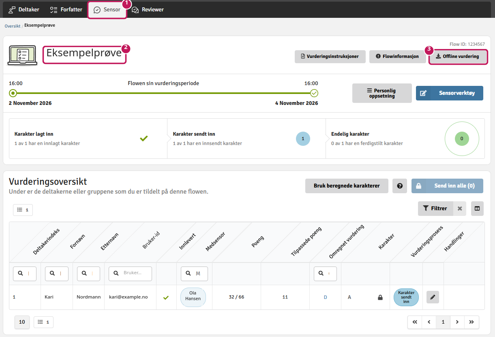

# WISEflow-samler

Slår sammen besvarelser fra WISEflow til PDF-er som er klare for utskrift. Du slipper inn zip-fila fra **Offline vurdering** og får enten **én PDF per kandidat** eller **én samlet PDF med alle kandidatene**.

**Bruk verktøyet:** <https://wiseflow-samler.roarstovner.no>

Du kan også laste ned [`index.html`](index.html) og åpne den i nettleseren.

## Besvarelsene forlater aldri maskinen din

Alt skjer i nettleseren på din egen maskin. Verktøyet har ingen server, og zip-fila lastes ikke opp noe sted.

- Sida har en innholdssikkerhetspolicy (`Content-Security-Policy`) som får nettleseren til å nekte sida å kontakte noen server. Du kan sjekke det selv: åpne utviklerverktøyene (F12 → Network) og se at det ikke kommer noen forespørsler mens zip-fila behandles.
- Verktøyet virker uten internett. Du kan koble fra nettet før du slipper inn fila.
- Hvis du vil være sikker på at koden ikke endrer seg mellom gangene du bruker den, laster du ned `index.html` og kjører den lokalt. Den trenger ingen installasjon eller administratorrettigheter, så den kan brukes på låste jobbmaskiner.

## Slik bruker du det

1. Gå til fanen **Sensor** i WISEflow.
2. Åpne riktig flow.
3. Klikk **Offline vurdering** øverst til høyre → gå gjennom de tre stegene → **Eksporter** → **Generer pakke**.
4. Last ned zip-fila, og slipp den inn i verktøyet. Du trenger ikke å pakke den ut.
5. Velg hva du vil ha, og klikk **Lag PDF**. Valgene er forklart i verktøyet.



Verktøyet støtter FLOWmulti, FLOWassign og FLOWlock. Rekkefølgen på delene hentes fra `_METADATA`-fila i pakken.

## Begrensninger

- **Fjerning av sensorveiledning** gjelder bare FLOWmulti-oppgaver med en svarboks med ramme rundt. Verktøyet fjerner alt mellom oppgavenummeret og svarboksen. Hvis oppgaveteksten også står der, forsvinner den også. Oppgaver uten svarboks, som flervalg, blir ikke endret. Se gjennom resultatet første gang du bruker verktøyet på en ny eksamen.
- Filer som ikke er PDF eller bilde, kommer ikke med i PDF-en.
- Verktøyet er testet med norskspråklige pakker. Pakker på andre språk bør virke når `_METADATA` finnes.
- **Navn vises ikke som standard.** Da fjernes navn og ID fra omslag, bunntekst, bokmerker, filnavn og skilleark, og omslaget lagres som bilde. Hvis verktøyet ikke kan fjerne navnet sikkert, utelates omslaget, og du får en advarsel. Navn som kandidaten selv har skrevet i besvarelsen eller vedlegg, blir ikke fjernet.
- **Bunnteksten** med deltakerindeks og sidetall skrives oppå sidene. Hvis en side har innhold helt nede ved kanten, kan teksten overlappe. Du kan slå den av i verktøyet.
- Verktøyet er ikke laget av eller tilknyttet UNIwise/WISEflow.

## Spørsmål og feil

Send e-post til [robast@oslomet.no](mailto:robast@oslomet.no). Ikke legg ved besvarelser.

## Bygge selv

`index.html` bygges av `src/template.html`. Bibliotekene og skjermbildet bygges inn i fila:

```sh
npm ci
python3 src/build.py
```

Bibliotekene er låst til faste versjoner i `package.json` og `package-lock.json`.

## Lisens

Koden i dette repoet er lisensiert under [MIT](LICENSE).

`index.html` inneholder disse åpen kildekode-bibliotekene, uendret:

- [PDF.js](https://github.com/mozilla/pdf.js) 3.11.174 fra Mozilla, Apache-2.0
- [pdf-lib](https://github.com/Hopding/pdf-lib) 1.17.1, MIT
- [JSZip](https://github.com/Stuk/jszip) 3.10.1, brukt under MIT (dobbeltlisensiert MIT/GPLv3)

Fullstendige lisenstekster, også for bibliotekene disse bygger på, står i [THIRD-PARTY-LICENSES.txt](THIRD-PARTY-LICENSES.txt).
